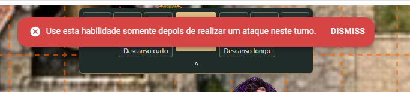
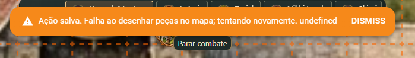
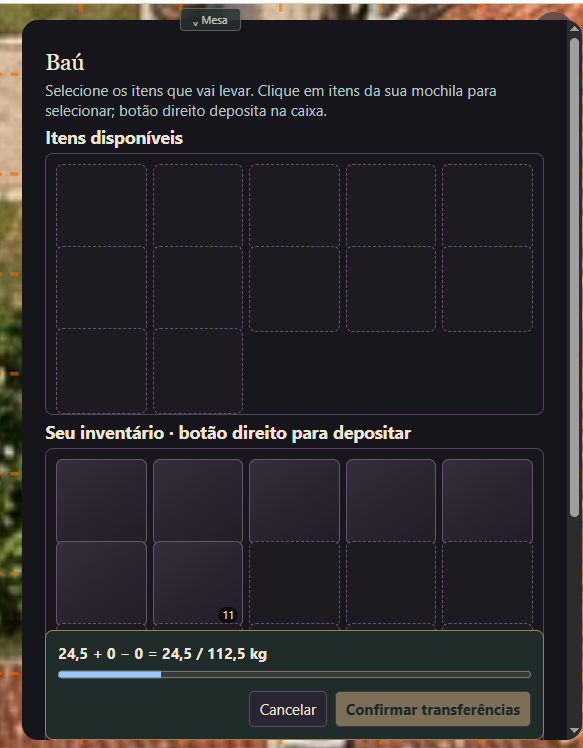
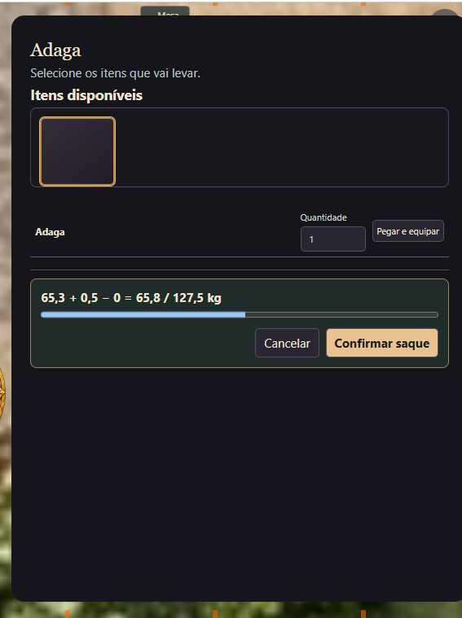

# Relato: arremesso, peças no mapa e saque — 0.8.46

Registro para investigação e implementação posterior. As imagens são relatos de uma mesa real; não demonstram, por si só, qual opção ou ficha foi usada em cada tentativa.

## 1. Arremesso e requisito de ataque

- Fora de combate surge “Use esta habilidade somente depois de realizar um ataque neste turno”. Em combate, algumas tentativas também foram bloqueadas mesmo com ação disponível.
- Em `engine.mjs`, `ataqueGeradoArma` associa `aposAtaque` a qualquer arma na mão fraca, inclusive à opção de arremesso; `validarRequisitos` exige um ataque anterior. Isso pode explicar a mensagem quando a opção escolhida é da mão fraca; a imagem não identifica a opção, então falta confirmar cada caso.
- Diferenciar ataque normal com qualquer mão e ataque adicional da propriedade Leve/Ágil. Verificar custos e histórico em combate e o comportamento livre fora dele, sem liberar incorretamente um ataque adicional gratuito.

## 2. Peça lançada falha ou demora a aparecer

- O usuário observou que a arma sai do inventário e o loot é criado junto ao alvo, mas o desenho demora e por vezes não aparece. A mensagem é “Ação salva. Falha ao desenhar peças no mapa; tentando novamente. undefined”.
- Em `bridge.mjs`, a sincronização cria imagem e área de seleção em chamadas distintas. Uma falha é capturada após a ação ser salva e há uma nova tentativa após 1,5 s. O texto usa `erroProps.message`, que pode ficar indefinido se o erro recebido não for um objeto Error. A causa exata da falha do SDK ainda não está identificada.
- Investigar logs e respostas reais do SDK, permissões do mestre, URL e formato da imagem, criação parcial de imagem/área e concorrência. Garantir reconciliação repetível e confirmação de que ambas as peças existem, inclusive após reconexão, sem duplicar nem restaurar itens. Mostrar erro útil; não depender de uma única tentativa.

## 3. Interface do baú

- Desejado: janela de saque semelhante à loja, contendo a grade do recipiente e seleção de itens a levar. O inventário do personagem fica na ficha, onde o botão direito oferece “Colocar no [nome do baú]”.
- Atualmente `saque.mjs` desenha também uma segunda grade com o inventário próprio dentro da janela e o botão direito nela apenas alterna o depósito. Adequar a integração entre as duas janelas, quantidades de pilhas, capacidade do recipiente, peso, sincronização e confirmação de transferência.
- Os itens no chão continuam sem opção de depósito. A sessão deve fechar ou ser invalidada quando o recipiente deixar de estar disponível ou sair do alcance.

## 4. Ícone ausente e equipar diretamente

- A adaga foi saqueada, mas sua célula apareceu sem arte. `saque.mjs` usa `celulaInventario` e `arteItem`; identificar se o item perdeu referência de catálogo/ícone ou se recursos de estilo/imagem da janela não carregam. Não presumir a causa sem reproduzir.
- Botão direito no item saqueável deve permitir equipar em mão compatível ou substituir o item equipado, que volta ao inventário. Quantidades, armas de duas mãos, capacidade de carga e custos de ação já definidos precisam ser respeitados.
- Existe um botão “Pegar e equipar” após seleção e o motor aceita `equiparSlot` em `confirmarSaque`, mas a interface atual abre o exame no botão direito e não envia uma escolha de mão. Conferir o funcionamento real também para pilhas; o motor atualmente exige selecionar a quantidade integral da pilha.

## Continuação

1. Reproduzir com as fichas e o fluxo reais, registrar arma, mão, fase, erro completo do SDK e estado do recipiente.
2. Corrigir o requisito do ataque e a reconciliação das peças, preservando as transações já salvas.
3. Reorganizar o saque e a ação contextual de depósito; implementar seleção de mão para equipar ou substituir.
4. Corrigir a arte e verificar saque de baú e item no chão, com pilhas, peso, alcance e custos em e fora de combate.
5. Verificar jogadores e mestre em uma sala real. A ordenação local de golpes desarmados permanece separada desta investigação.
